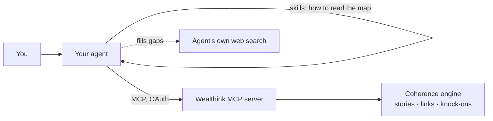

# Wealthink for agents

**Understand Indian markets from inside your AI agent.**

Wealthink is a **coherence engine** for Indian markets. It reads recent
financial news and links it into one map: each story is tied to its causes and
consequences, labelled with the companies, sectors and macro drivers it moves,
and traced to its **knock-on effects** on other industries.

This repo connects that map to your agent over [MCP](https://modelcontextprotocol.io)
and ships the skills that teach the agent to use it well. Ask a market
question and get a connected, cited answer: what is happening, why, how it
reaches you, and what supports or challenges your view.

Works with **Claude Code, Claude.ai, Claude Desktop, Cowork, Codex, Cursor,
Gemini CLI, VS Code, ChatGPT** and any other MCP client.

---

## Set up in one paste

Copy this into your agent. It installs what it can and tells you the rest:

```text
Set up Wealthink for me. Wealthink links Indian market news into connected stories and is used through MCP.

1. Read the setup guide and follow the steps for the agent you are:
   https://raw.githubusercontent.com/Wealthink/wealthink-plugin/main/wealthink-plugin/skills/connect/SKILL.md
2. Add the Wealthink MCP server (https://api.thewealthink.com/mcp, OAuth) and install the Wealthink skills if you support skills.
3. I sign in to Wealthink in my browser. Never ask me for an email, password or token.
4. When it's connected, call get_my_usage and get_pool_pulse and tell me in two lines what my plan includes and what's moving Indian markets today.

If you can't install things yourself (for example in a chat app), tell me exactly what to click instead.
```

You sign in once in your browser. There is no API key to copy, and nothing
should ever ask you for a password.

## What you can ask

| Ask | What you get |
|---|---|
| "What's moving Indian markets today?" | The sectors the last 24 hours of news helped or hurt, the macro drivers behind it, and the stories still developing |
| "What's going on with PB Fintech?" | The company's recent stories, how they connect, and whether the news is good or bad for the business |
| "How is crude oil hitting other sectors?" | The driver's moves and the knock-on chain into other industries, marked as Wealthink's reasoning |
| "Why did the RBI hold, and what came of it?" | The story's timeline: the earlier stories that led to it and what followed |
| "Does the news back my view on cement?" | The stories that support and the ones that challenge it |
| "Run a thesis check on: rate cuts will lift NBFC margins" | Wealthink's Thesis Check scores the statement against the news (Starter) |
| `/wealthink <anything>` | In Claude Code: routes any market question to the right skill |

Every claim cites the story it came from, so you can open the source. Company
arrows describe the effect on the business, not a price call. Nothing here is
investment advice.

## How it works



- **The MCP server** (`https://api.thewealthink.com/mcp`) serves your plan's
  tools: the market pulse, story lists by sector, driver or company,
  knock-ons, story timelines, articles, and Thesis Check.
- **The skills** teach the agent what each tool returns, to list before
  opening, to follow story links, to keep Wealthink's reasoning apart from
  what articles say, and to cite every story.

## Install by hand

<details>
<summary><b>Claude Code</b> (recommended: the full plugin)</summary>

```bash
claude plugin marketplace add Wealthink/wealthink-plugin
claude plugin install wealthink@wealthink
```

Restart Claude Code (`claude --continue` keeps your conversation), run `/mcp`,
choose **`plugin:wealthink:mcp`**, then **Authenticate**.

This brings the MCP server, all the skills, the `/wealthink` command and a
hook that asks before every Thesis Check.

To update: `claude plugin marketplace update wealthink`, then
`claude plugin update wealthink@wealthink`.
</details>

<details>
<summary><b>Claude.ai, Claude Desktop, Cowork</b></summary>

**Customize → Plugins** → add the marketplace `Wealthink/wealthink-plugin` →
install **Wealthink for agents** → authorise the connector when asked.
</details>

<details>
<summary><b>Codex, Cursor, Gemini CLI, VS Code, OpenCode and others</b></summary>

Install the skills (open [Agent Skills](https://agentskills.io) format):

```bash
npx skills add Wealthink/wealthink-plugin
```

Then add the MCP server, named `wealthink`. For example, Codex:

```bash
codex mcp add wealthink --url https://api.thewealthink.com/mcp
codex mcp login wealthink
```

[`docs/connect.md`](./docs/connect.md) has the config for every client.
</details>

<details>
<summary><b>ChatGPT</b></summary>

Settings → Apps & Connectors → Advanced → turn on **Developer mode** (paid
plans) → add a connector with URL `https://api.thewealthink.com/mcp` and OAuth.
ChatGPT can't load skills, so paste
[`docs/agent-instructions.md`](./docs/agent-instructions.md) into your
project's instructions.
</details>

## Plans

| | Free | Starter |
|---|---|---|
| News history | Last 3 days | Last 30 days |
| Story opens | 100 a day | Unlimited |
| Pulse, stories, knock-ons, timelines | ✓ | ✓ |
| Thesis Check | — | 40 a week |

This plugin is built for **Free and Starter**. On **Pro and above**, use the
Wealthink desktop app, which ships its own plugin for research modules and
reports. See [pricing](https://www.thewealthink.com/pricing).

If you ask for more than your plan includes, the agent tells you once, in
plain words, which plan has it, and answers from what you have.

## What's in this repo

```
.claude-plugin/marketplace.json   the Claude marketplace listing
wealthink-plugin/                 the plugin
├── .mcp.json                     the Wealthink MCP server (OAuth)
├── skills/
│   ├── connect/                  setup guide for every agent (the prompt above reads it)
│   ├── coherence-engine/         what Wealthink is, the data model, every tool
│   ├── market-pulse/             what's moving today
│   ├── market-context/           a company, sector, driver or portfolio, and your view
│   ├── trace-story/              one story's causes, consequences and reach
│   └── thesis-check/             Thesis Check (Starter)
├── commands/wealthink.md         /wealthink <question>
└── hooks/                        session reminder; asks before each Thesis Check
docs/
├── connect.md                    setup for every client
└── agent-instructions.md         a system prompt for agents without skills
```

More detail on the skills, tools and limits:
[`wealthink-plugin/README.md`](./wealthink-plugin/README.md).

## Privacy

The agent signs in to your own Wealthink account with OAuth and sees only your
account. Wealthink never needs your password in the chat, and the plugin stores
no credentials; your agent keeps and refreshes the sign-in itself.

## Support

Email [support@thewealthink.com](mailto:support@thewealthink.com) or open an
issue on this repo.

## License

MIT. See [LICENSE](./LICENSE).
